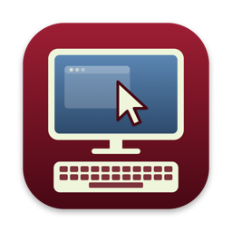

# KVM Serial Native for macOS



A native macOS app for controlling a second computer through a **CH9329**
UART-to-USB-HID bridge and an HDMI capture card, built for the lowest possible
input and video latency.

It is based on [kvm-serial](https://github.com/sjmf/kvm-serial) by Samantha
Finnigan and contributors, a cross-platform Python app (Windows, macOS, Linux)
that supports both the CH9329 and the CH9350L. This project is a separate
Swift and AppKit rewrite for macOS and the CH9329 only. If you need Windows or
Linux, the CH9350L, or a headless CLI, use
[kvm-serial](https://github.com/sjmf/kvm-serial).

## What it does

You plug a CH9329 cable or module into the computer you want to control (the
*target*) and its HDMI output into a USB capture card on your Mac. The app
shows the target's screen in a window and sends your keyboard and mouse to it
over serial. The target sees an ordinary USB keyboard and mouse, so it works
in BIOS/UEFI setup screens, at login windows, and on machines with no remote
desktop software.

## Why a native app

The kvm-serial Python GUI works on macOS, but several of its design choices add
latency there. This app is built around removing them:

| | kvm-serial Python GUI | This app |
|---|---|---|
| Mouse moves | Every move is written to serial on the UI thread; at 9600 baud the moves queue up and the cursor falls behind | A sender thread keeps only the newest position while the line is busy, so the cursor never lags behind a backlog |
| Serial speed | 9600 baud by default | Can switch the chip to 57600 or 115200 (about 13.5 ms per mouse packet at 9600, 1.1 ms at 115200) |
| Video | Frames converted to ARGB and painted on the CPU | Native capture format drawn by Metal with no CPU copies; late frames dropped |
| Keyboard | Keys mapped through character tables; releasing one key can drop another that is still held | Physical key positions, left/right modifiers kept apart, 6 keys held at once |

Measured on one setup (UltraSemi "USB3 Video" card, 1080p60): about 25–32 ms
from the capture timestamp to the frame being on screen, about 19 ms of which
passes inside the capture card and USB before the app receives the frame.

## Hardware

- **A CH9329 cable or module.** Search for "CH9329 cable" on eBay or AliExpress.
  It must say CH9329: a plain USB-A to USB-A cable won't work and can damage
  your machines. A home-made CH9329 + CP2102/CH340 module works too. See
  kvm-serial's [CH9329 guide](https://github.com/sjmf/kvm-serial/blob/main/docs/CH9329_GUIDE.md)
  for wiring.
- **An HDMI (or VGA) to USB capture card.** A USB 3 card that offers an
  uncompressed format (YUY2) at 1080p60 gives the lowest latency.

## Requirements

- macOS 14 or later
- To build from source: Xcode with Swift 6

## Install

Download the DMG from the
[latest release](https://github.com/alex0com/kvm-serial-macos/releases/latest),
open it, and drag **KVM Serial Native** to Applications.

The app is ad-hoc signed, not notarized, so macOS blocks it the first time.
Right-click the app and choose **Open**, or run:

```bash
xattr -dr com.apple.quarantine "/Applications/KVM Serial Native.app"
```

On first launch macOS asks for camera access. The app needs it to read your
capture card.

## Build from source

```bash
git clone https://github.com/alex0com/kvm-serial-macos.git
cd kvm-serial-macos
swift test                     # unit tests
./scripts/build-app.sh         # build/KVM Serial Native.app
./scripts/build-dmg.sh         # build/KVM-Serial-Native-<version>-macOS-<arch>.dmg
open "build/KVM Serial Native.app"
```

The version number is in `VERSION`. The icon is generated by
`swift scripts/make-icon.swift`, which writes `Resources/AppIcon.icns`.

## First run

1. Connect the CH9329 and the capture card, then open the app.
2. The app picks the first USB serial port and the first capture device. If it
   picks the wrong ones, choose others from **Device › Serial Port** and
   **Device › Video Device**.
3. The app finds the chip's baud rate automatically. The window subtitle shows
   the connection state.
4. Optional but recommended: **Device › Change Chip Baud Rate…** switches the
   CH9329 from its factory 9600 baud to 57600 or 115200, which makes the mouse
   much more responsive. The setting is saved on the chip. The CH9329 does not
   support 115200 when it runs at 3.3 V, so choose 57600 if you're not sure of
   your module's voltage.

## Using it

- **⌃⌥Esc** turns input capture on and off. While capture is on, every key goes
  to the target, including ⌘ shortcuts, so this app's own menu shortcuts don't
  work. Use the menu bar with the mouse, or turn capture off first.
- **Keys:** Ctrl is sent as Ctrl and ⌘ as the Windows/Command key.
  **Input › Send ⌘ as Ctrl** swaps them, so ⌘C copies on a Windows or Linux
  target.
- **Input › Target Is a Mac:** turn this on when the target computer is a Mac.
  macOS only moves windows on relative mouse motion and ignores button presses
  sent on the CH9329's relative report. With this on, clicks are sent as
  absolute positions, and motion while a button is held is sent as relative
  steps.
- **Input › Capture System Shortcuts** also forwards ⌘Tab, ⌘Space and Mission
  Control shortcuts to the target. It needs the Accessibility permission.
- **Input › Paste as Keystrokes** (⌘V while capture is off) types your
  clipboard on the target, using the layout in **Input › Paste Layout**
  (en_GB, en_US, pl_PL).
- **Input › Send Ctrl+Alt+Del**
- **View › Show Latency HUD** (⌘L while capture is off) shows the capture frame
  rate, capture-to-screen time, serial packet rate, how many mouse moves were
  merged, and the target's USB and lock-key state.
- **View › Fit Window to Video** and **View › Enter Full Screen** (⌃⌘F).

Settings are saved in the `com.alex0com.kvm-serial-macos` defaults domain.

## Known limitations

- **CH9329 only, absolute mouse only.** There is no CH9350L support and no
  pointer-lock relative mode, which some BIOS screens and games need.
- **Mac targets: the pointer jumps slightly after a drag.** Relative motion is
  sped up by the target's pointer acceleration, so during a drag the target's
  cursor drifts from your pointer, then jumps to the right place when you let
  go. The dragged window itself lands where you saw it.
- **Capture resolution.** Many cheap capture cards accept 1440p or 4K input but
  send at most 1920×1080 over USB, scaling everything else down. A target set
  to an unusual resolution such as 2048×1080 looks slightly squeezed. Clicks
  still land in the right place. For the sharpest picture and lowest latency,
  run the target at 1920×1080 at 60 Hz.
- **Not notarized.** See [Install](#install).
- Paste as Keystrokes, Send Ctrl+Alt+Del, Capture System Shortcuts and the
  lock-key display have had less real-world testing than the core keyboard,
  mouse and video paths.

## Troubleshooting

- **"No reply from a CH9329":** check the cable, then try **Device › Serial
  Port › Reconnect**. The app tries every supported baud rate, so a chip whose
  rate was changed is still found.
- **The serial port won't open:** the app opens the port exclusively, so close
  any other program using it, such as the kvm-serial Python app.
- **Black video or "Camera access denied":** allow KVM Serial Native in System
  Settings › Privacy & Security › Camera.
- **⌘Tab doesn't reach the target:** enable KVM Serial Native in System
  Settings › Privacy & Security › Accessibility, then choose **Input › Capture
  System Shortcuts** again. Because the app is ad-hoc signed, macOS may forget
  this permission after you rebuild it.
- **Logs:** `/usr/bin/log show --predicate 'subsystem == "com.alex0com.kvm-serial-macos"' --info --last 5m`

## How it works

The Swift package has two targets:

- **KVMCore**: a library with no UI, covered by unit tests. It contains:
  - the CH9329 protocol, with packets checked byte for byte against
    kvm-serial's Python implementation;
  - the serial port and the sender thread that merges mouse moves;
  - the keyboard mapping and state.
- **KVMSerial**: the app. It contains:
  - AVFoundation capture;
  - the Metal renderer;
  - input handling;
  - menus, settings and the HUD.

## Credits and license

Released under the [MIT License](LICENSE).

- Based on [kvm-serial](https://github.com/sjmf/kvm-serial) by Samantha
  Finnigan and contributors (MIT). The CH9329 protocol code, keyboard layouts,
  colour palette and much of this documentation are derived from it.
- kvm-serial's CH9329 code was in turn derived from
  [beijixiaohu/ch9329Comm](https://github.com/beijixiaohu/CH9329_COMM/) (MIT).

This project is not affiliated with kvm-serial or with any hardware
manufacturer.
